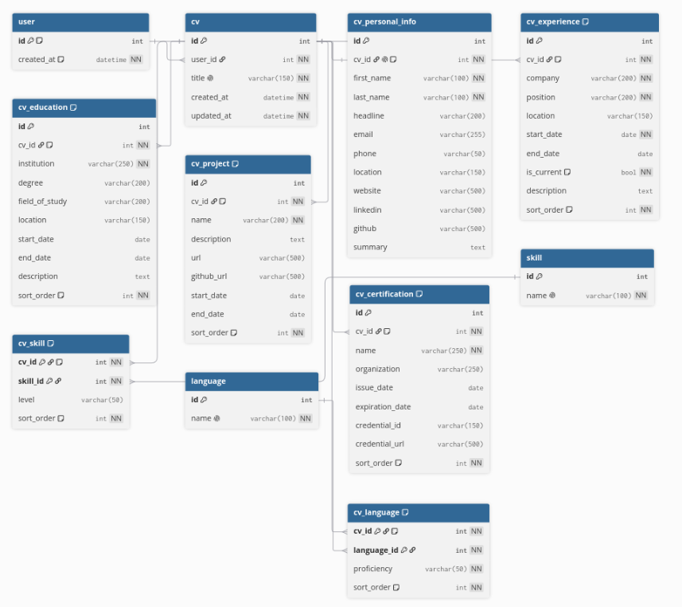

<div align="center">


# Stellar

**REST API for creating and managing resumes, with PDF export using customizable templates.**

[](https://www.python.org/)
[](https://fastapi.tiangolo.com/)
[](https://sqlmodel.tiangolo.com/)
[](https://www.postgresql.org/)
[](https://redis.io/)
[](https://www.docker.com/)
[](https://jwt.io/)

</div>

## Description

Stellar is a FastAPI service for creating and managing resumes, including personal information,
work experience, education, skills, languages, projects, and certifications. It supports
JWT authentication and PDF generation with six templates and English, Russian, and Latvian.

## Technology stack

Python 3.14 · FastAPI · SQLModel · PostgreSQL 18 · Redis 8 · JWT · WeasyPrint · Docker Compose

## Run with Docker Compose

Create `.env` from the provided example and set your own secure values for
`POSTGRES_PASSWORD` and `JWT_SECRET_KEY`:

```bash
cp .env.example .env
```

If it does not already exist, create the external Docker network required by Compose, then start:

```bash
docker network create back_end
docker compose up --build -d
```

The API and interactive documentation are available at [localhost:8001](http://localhost:8001)
and [localhost:8001/docs](http://localhost:8001/docs). PostgreSQL is exposed on port `5440`;
Redis is exposed on port `6380`.

## Database schema


